# CL RACE 2026 — User Guide

A photo-scavenger-hunt race for teams on foot. Teams log in on their phones, get one checkpoint at a time, walk there, take a photo of the required shot, upload it, and an admin approves it and awards points. First team to finish all checkpoints wins; the best photos go into a public Hall of Fame.

This guide covers both deployments that ship in this repository:

| Instance | Folder | Public URL | Content set | Checkpoints |
|---|---|---|---|---|
| **CL RACE 2026** | `clrace/` | https://clrace2026.clreport.com | Dry / Haze | 7 |
| **CLI RACE 2026** | `clirace/` | https://clirace2026.clreport.com | Wet Weather | 9 |

Both run exactly the same code and the same game mechanics. Only the checkpoint content and the branding badge differ, so every step below applies to either site — just use the URL you were given.

---

## 1. Before the event — setup checklist

Do this the day before, not on the morning.

- [ ] Both backends are up: open the site URL, the login screen should appear.
- [ ] Health check returns OK: `https://<host>/api/health` → `{"ok": true, ...}`.
- [ ] All 12 team accounts and 4 admin accounts exist (seeded automatically on first run).
- [ ] Checkpoint reference photos are loaded for every checkpoint (admin → **CPs**).
- [ ] Race status is **not_started** and every team shows **ready**.
- [ ] At least one phone per team has been tested: login, camera permission, upload.

> **The race cannot start itself.** A team only begins when an admin presses **Release** for that team. Everything is driven from the admin side.

---

## 2. Signing in

### Admins

Open the site on a laptop and sign in with the organiser account.

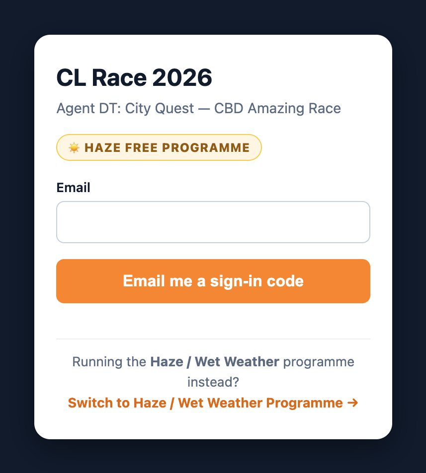

**Sign-in is by email code — there is no password field.** Enter the organiser mailbox, press **Email me a sign-in code**, then type the six digits from the message. Press **Enter** in either field instead of clicking if you prefer; a double-submit guard means one press is enough. The code expires after 10 minutes, works once, and the form always says the same thing no matter which address is typed, so it never reveals who is allowed in. You land on the dashboard.

### Teams

Team leaders used to open the same URL on their phones and sign in with their own team account. **That access has been removed now the race is over** — team and staff logins are disabled, and only the organiser mailbox can obtain a code. The screenshots and the rest of this guide are kept as a record of how the game ran. The layout is mobile-first: mission card on top, timer on the right, navigation as **Mission / Hall of Fame / Menu**.

> There is deliberately **no password-change screen** and no self-registration. Seeded passwords are only used when recreating a fresh database (see the README, `RACE_ADMIN_PASSWORD` / `RACE_TEAM_PASSWORD`); they cannot be used to sign in on the live instances.

---

## 3. Admin dashboard — where the race is controlled

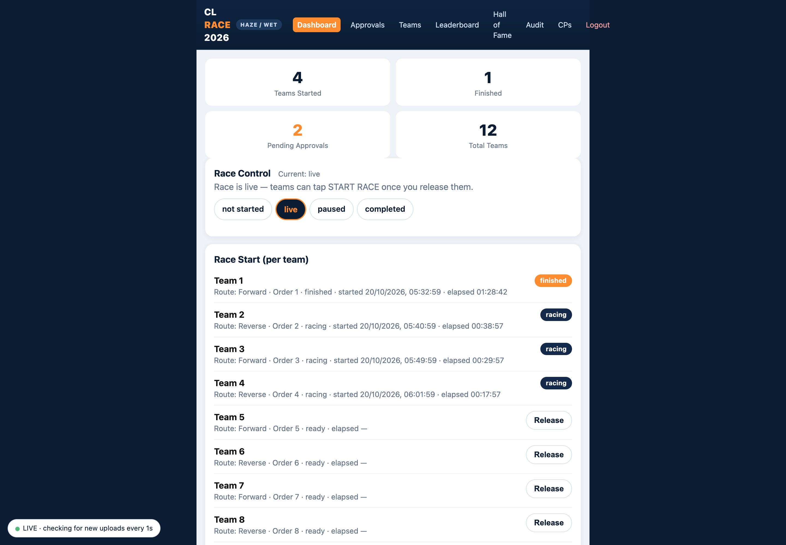

Top navigation: **Dashboard · Approvals · Teams · Leaderboard · Hall of Fame · Audit · CPs · Logout**.

The dashboard carries the **Race Control** card. Two things happen there:

1. **Race status** — flip the event to **live** before releasing anyone. Until it is `live`, a start attempt returns `409 {"detail": "Race is not live"}` — this is the single most common "why can't the race start?" cause.
2. **Release** — for each team in turn, press **Release** (or use the button on the Teams page). This stamps `started_at` and starts that team's clock.

When Race Control is live the status pill blinks, so you can tell at a glance that the event is running.

> **Staggered starts:** teams are released manually, roughly one every few minutes (the demo setting is 5 minutes, but the interval is only advisory — nothing enforces it, the order is what matters). This is what spreads the crowd across the course.

---

## 4. Releasing teams

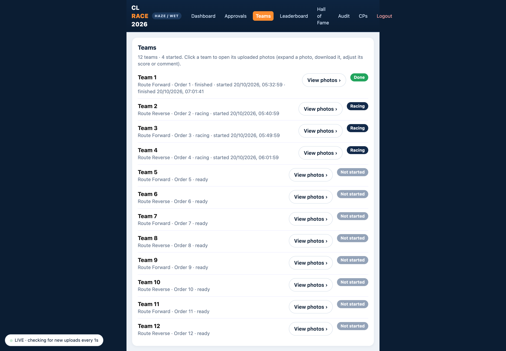

The **Teams** page lists all 12 teams with status (`ready` / `racing` / `finished`), release order, start time and elapsed time. Each row has a **Release** action for teams that have not started yet and a link into the team's detail page.

Release order is fixed by the seed (1 → 12); releasing out of order is allowed but makes the leaderboard harder to reason about.

---

## 5. What the team sees

### The mission card

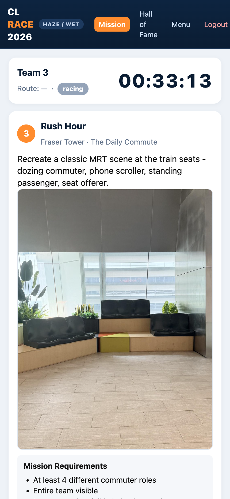

A racing team sees exactly one checkpoint: **CP number, checkpoint name, location, the task description, and the reference photo** of the shot they have to reproduce. Bonus conditions (e.g. "Bonus 5 Points: most synchronised jump") appear as a *📝 Note* line under the task.

The card also shows:

- **Team name** and **route** — odd release order walks the checkpoints forward, even release order walks them in reverse, so two teams never trail each other.
- **Live elapsed timer**, in `HH:MM:SS`, driven by the server from `started_at`. It keeps counting even if the phone sleeps; on finish it freezes at `final_elapsed_seconds`.
- The **upload area** (see next section).

Anti-peek is built in: the app only ever sends the *current* checkpoint to a team. Future checkpoints simply do not exist in the client's data — a team that inspects the page source learns nothing.

### Submitting a photo

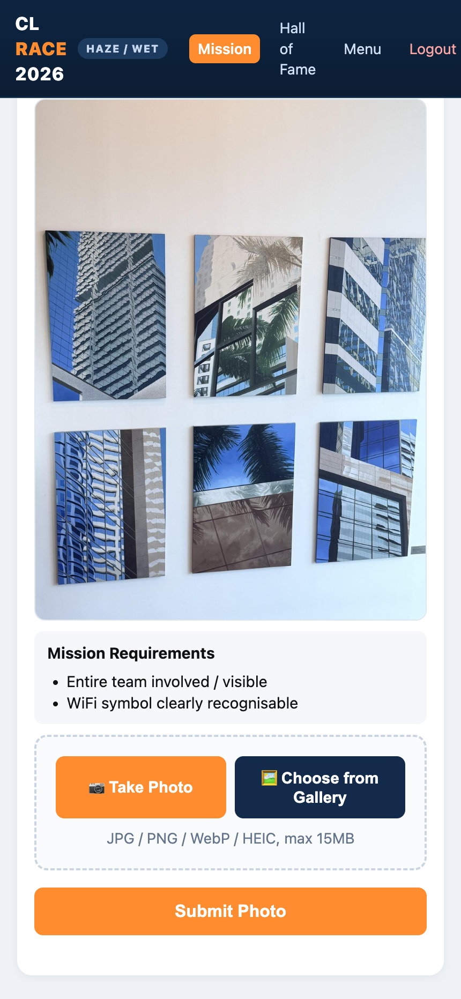

There are always **two** buttons:

- **📷 Take Photo** — opens the camera directly.
- **🖼️ Choose from Gallery** — opens the photo picker.

Both are needed: a single camera-only input would make it impossible to upload a shot that was taken a minute earlier (or by a teammate's phone). The chosen photo previews immediately, then **Submit** uploads it.

Server-side handling: HEIC/HEIF from iPhones is accepted, EXIF orientation is applied, GPS metadata is stripped, and images are downscaled (1600 px full / 480 px thumbnail) before they are stored.

### Waiting for approval

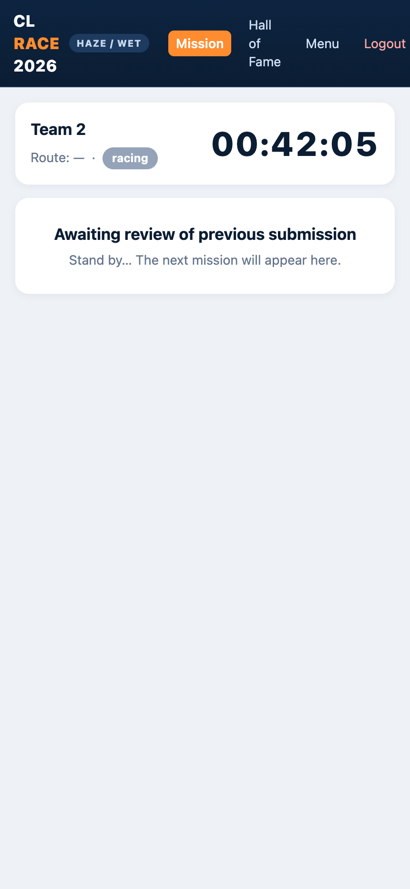

After submitting, the team sees **"Awaiting review of previous submission — stand by, the next mission will appear here."** The next checkpoint unlocks only when an admin approves that photo. That pause is intentional: it is the moment the admin scores the photo and keeps the queue honest.

If a photo is rejected, the same checkpoint comes back with the admin's reason, and the team can shoot it again (attempt number increments).

### Menu

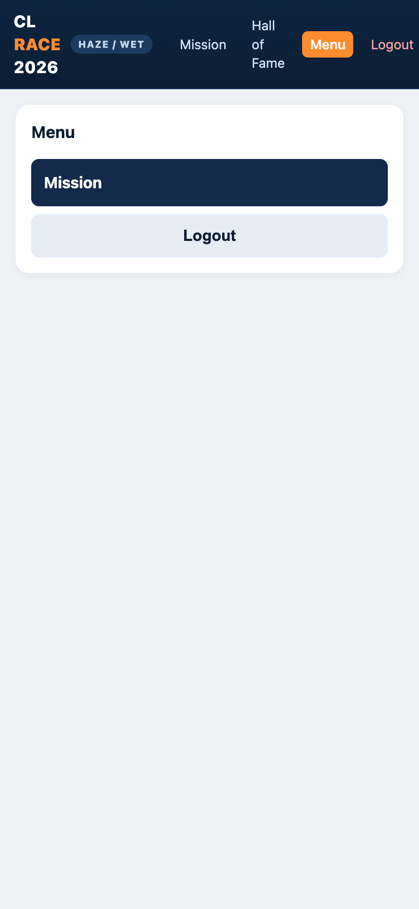

The **Menu** tab holds the team's own view: their submissions so far, their score, and the logout button. Handy when a team asks "did you get my photo?" — they can see it themselves, including the admin's comment.

---

## 6. Approving and scoring

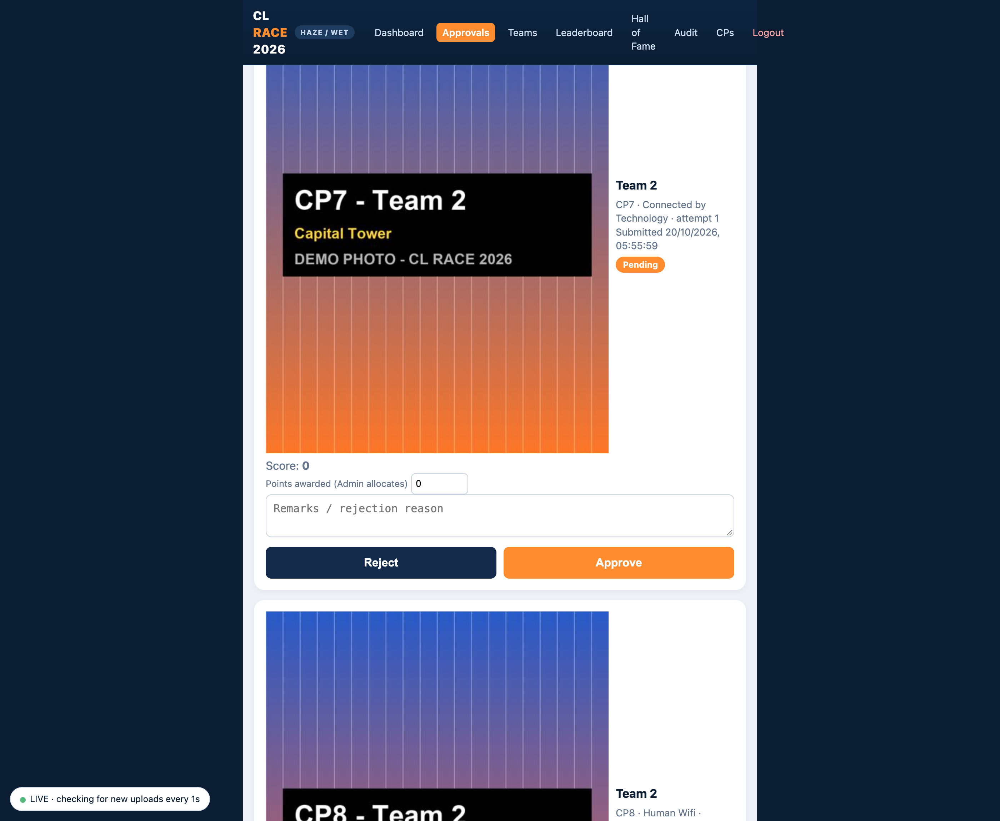

**Approvals** shows every photo waiting for review, newest first, filterable by team. For each card you see the submitted photo, the reference photo, the team, the checkpoint, the attempt number and the timestamp.

Two rules that trip people up:

- **There are no base points.** The admin types the points for every photo. The field starts at 0 and stays at 0 unless you move it.
- **Replace before review.** If a team submitted the wrong photo and you have not reviewed it yet, they can simply re-upload — the newer photo replaces the older one and no reject is needed. Rejecting is for photos that were reviewed and are wrong.

Actions:

- **Approve** — saves the points, marks the submission `completed`, unlocks the team's next checkpoint.
- **Reject** — requires a reason in *Remarks*; the team sees it, and the checkpoint is re-opened.
- **Remarks** double as a public caption; the Hall of Fame shows them.

The pill at the bottom (`LIVE · checking for new uploads every 1s`) means the page refreshes itself — you do not need to reload to see the next upload land.

---

## 7. Team detail — scoring a photo after the fact

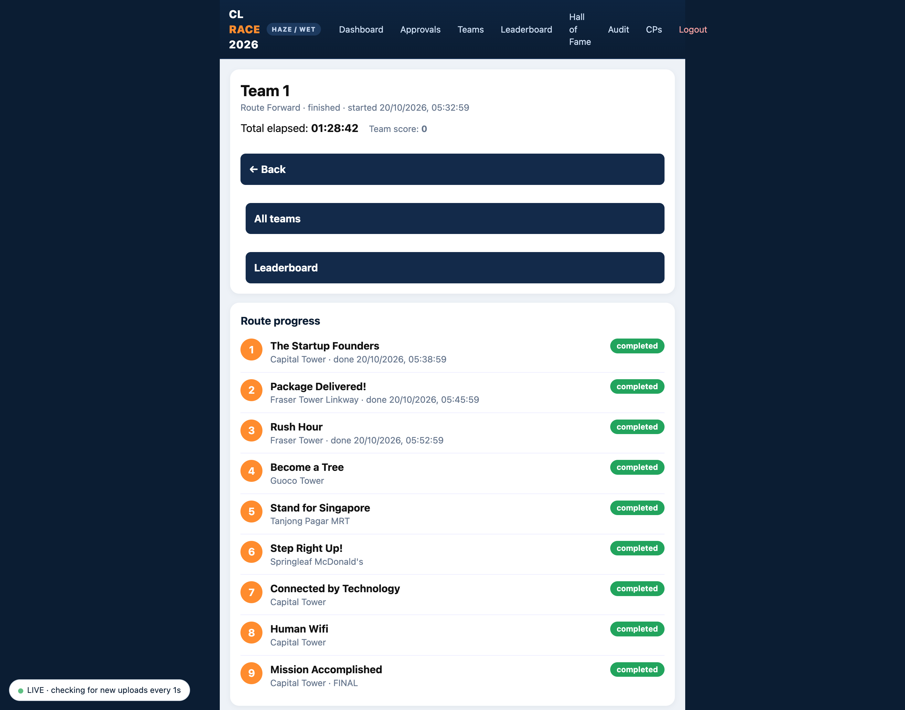

Clicking any team opens its detail page: every checkpoint with its photo, the score awarded, the admin comment, and an editable points field. Use it to:

- Correct a score that was typed wrong (the change is stored as a `score_adjustment` delta, and the leaderboard picks it up immediately).
- Add a comment for the Hall of Fame.
- See how far a team has actually got, checkpoint by checkpoint.

---

## 8. Leaderboard

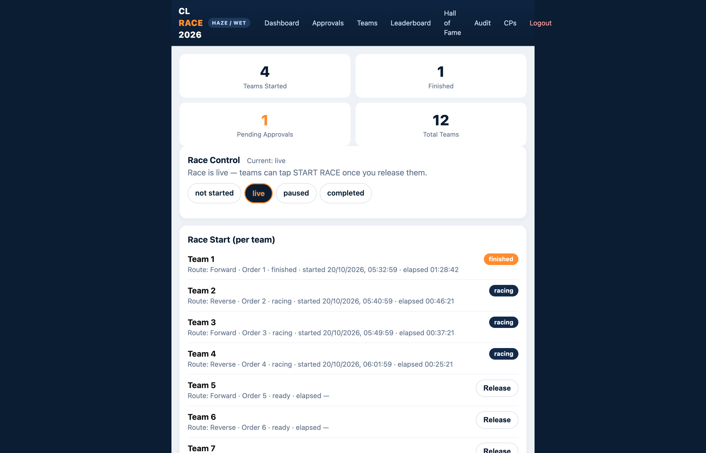

Columns: rank, team, **score**, **done** (approved checkpoints), **elapsed**. Elapsed is *now − start*, frozen once the team finishes, so a finished team's time never drifts.

- The **±** button on a row applies a manual score adjustment (penalty, bonus, correction) and is written to the audit log.
- **Export CSV** downloads the current standings — useful for the presentation and for the post-event write-up.
- Completion bonus (10 / 8 / 5 points for 1st / 2nd / 3rd) is applied automatically when a team's last checkpoint is approved.

The leaderboard is visible to teams too (a setting); hide it in **Settings** if you want the result kept as a surprise.

---

## 9. Hall of Fame

### Admin: pick the highlights

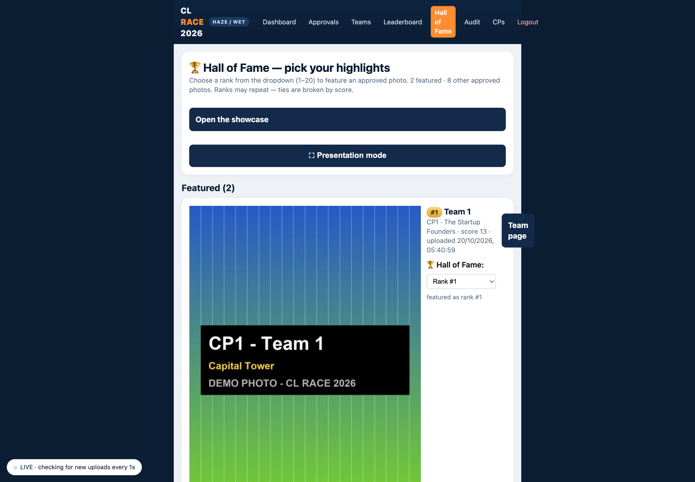

**Hall of Fame** lists every approved photo. For the ones you want to feature, choose a rank from the dropdown (1–20). Ranks may repeat — ties break on score. Two buttons matter:

- **Open the showcase** — the public gallery.
- **Presentation mode** — full-screen, for projecting at the closing ceremony.

Only photos whose team has **finished** are eligible. Featuring a photo mid-race would leak the course to teams still walking.

### Public: the showcase

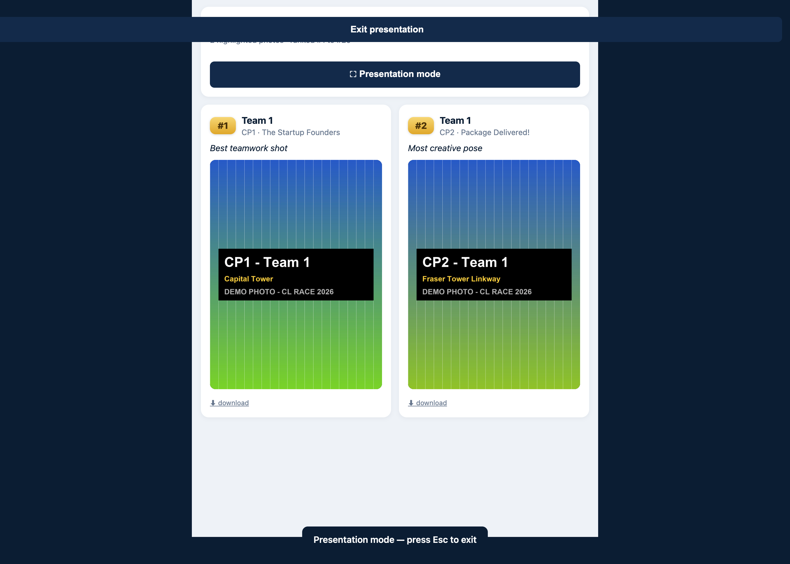

`https://<host>/#/hall` (API: `GET /api/hall-of-fame`, no login needed) shows the featured photos ranked, each with its caption, team, checkpoint and a download link. This is the page you put on the projector, and the link you send to participants afterwards.

---

## 10. Checkpoints and content

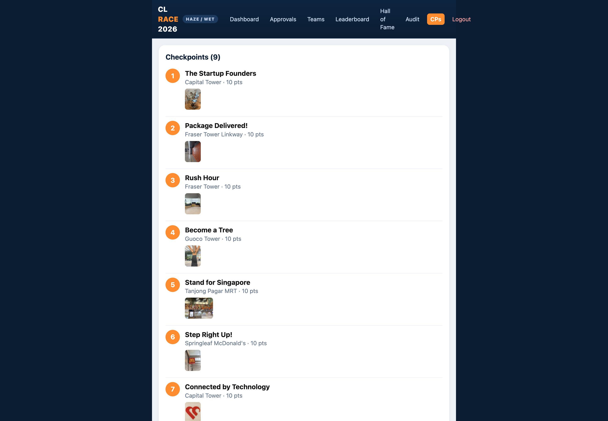

The **CPs** page is the content editor: checkpoint number, name, location, task text, bonus description, reference photo and the bonus/points guidance. Edits take effect for the *next* time a checkpoint is served, so freeze content once the race is live.

The wet-weather set (9 checkpoints around Tanjong Pagar) and the dry set (7 checkpoints) are both seeded from `backend/app/seed.py`; see `docs/CLRACE2026-REQUIREMENTS.md` for the full content list.

---

## 11. Day-of runbook

| Time | Admin action |
|---|---|
| T-60 min | Open the dashboard, confirm race status `not_started`, all teams `ready`. Test one phone login. |
| T-15 min | Brief the teams: one checkpoint at a time, take the photo at the spot, wait for approval. |
| T-5 min | Set race status to **live**. |
| T-0 | **Release** Team 1. Watch the timer start on their phone. |
| +5 min | Release Team 2, then continue every few minutes down the list. |
| During | Keep the Approvals tab open. Score each photo, approve, keep the queue short. |
| Finish | Last team's final approval → check the Leaderboard, export CSV, pick Hall of Fame ranks. |
| Close | Presentation mode on the projector, then share the public showcase link. |

---

## 12. Troubleshooting

| Symptom | Cause / fix |
|---|---|
| "Race is not live" (409) when starting | Set race status to **live** in Race Control first. Release is the only start trigger. |
| Release button does nothing | The team already has `started_at` set — it is racing or finished. Check Teams. |
| Team stuck on "Awaiting review" | Their last photo is still `pending`. Approve or reject it in Approvals. |
| Team says the photo never arrived | Ask them to check **Menu → my submissions**: the photo is either there (awaiting review) or the upload failed on a weak signal; re-upload from the gallery. |
| Wrong photo approved | Team detail → edit the points, or reject and let them reshoot. Corrections are logged as adjustments. |
| Leaderboard score looks wrong | Team detail → per-photo scores; the ± adjustment on the leaderboard row is for one-off corrections only. |
| Site not loading on a phone but fine on laptop | Usually a stale DNS cache on the phone — toggle airplane mode, or use mobile data. |
| Pages look stale after a deploy | The HTML is served `Cache-Control: no-store`, so a normal reload is enough. |

---

## 13. Where to read more

- **`docs/CLRACE2026-REQUIREMENTS.md`** — the full functional and technical specification: data model, endpoints, photo pipeline, acceptance criteria.
- **`README.md`** — how to run either instance locally, environment variables, and how the two deployments are hosted.
- **`<instance>/backend/smoke_test.py`** — end-to-end test of the whole flow against a local instance.
